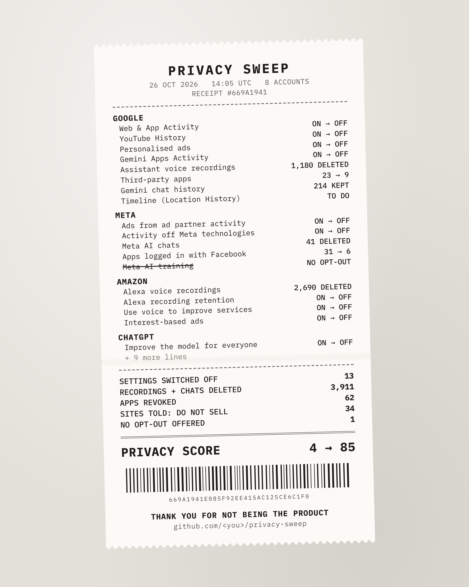

# Privacy Sweep

**Switch off the tracking, recordings and data-sharing your accounts turned on for you. Free, about 20 minutes, nothing changed without your OK, nothing leaves your device.**



Google, Meta, Amazon, Microsoft, ChatGPT, LinkedIn, X and GitHub each bury dozens of settings that track you, keep your voice recordings, train AI on your posts, or let old apps read your email. They're spread over 30+ pages and change every few months. Privacy Sweep has a coding agent find them all, show you what's on, and switch off what you approve.

## What it does

| Module | What it finds | What it does |
|---|---|---|
| **Settings sweep** | Ad personalisation, activity and location tracking, off-platform tracking, AI training on your data | Switches them off |
| **Recordings purge** | Alexa and Assistant voice recordings, Gemini, ChatGPT, Meta AI and Grok chats | Offers an export, then deletes only what you confirm |
| **App audit** | Every third-party app that can still access your Google, Facebook, Microsoft, X, LinkedIn or GitHub account | Revokes the ones you pick |
| **Do not sell** | Global Privacy Control in your browser, opt-out-of-sale links on sites you use | Turns on GPC and submits opt-outs (binding in CA, CO, CT, NJ and other US states) |

## Safe by design

- **Audit first.** The first pass changes nothing. You see a table of everything that's on.
- **You approve each change.** Deletions get their own yes/no and an export offer first.
- **Never touches your passwords.** With an agent, you log in yourself in the browser window.
- **Know what an agent can see.** While an AI agent runs, it can read the pages you're logged into, and that text goes to the AI provider. Prefer not to? The guided page needs no AI and nothing leaves your browser. After an agent run, delete the `.profile` folder to sign the automation browser out.
- **Everything is reversible except deletes,** and the receipt records the before state.
- **Runs on your machine.** The browser profile and receipts stay local.

## Pick how you run it

| You use | How | Time |
|---|---|---|
| **Nothing, no AI** | Open the [guided page](https://Karmoola.github.io/privacy-sweep/): pick your accounts, open each link, flip the setting, tick it off | 20 to 40 min |
| **A browser agent** (ChatGPT agent or Atlas, Perplexity Comet, Claude in Chrome, Gemini in Chrome, Copilot in Edge) | Paste [`dist/PROMPT-browser-agent.md`](dist/PROMPT-browser-agent.md), then paste the JSON it gives you into the guided page's Import box | 10 to 20 min |
| **A coding agent** (Claude Code, Codex, Gemini CLI, Cursor, Copilot) | Steps below | about 15 min |

Every path ends with the same receipt card. The guided page runs entirely in your browser; nothing you tick is sent anywhere.

### Coding agent setup

1. ```
   git clone https://github.com/Karmoola/privacy-sweep && cd privacy-sweep && npm install
   npx playwright install chromium   # for the receipt image
   ```
2. Add the Playwright MCP server to your agent, pointing at a local profile:
   - Claude Code: `claude mcp add playwright -- npx @playwright/mcp@latest --user-data-dir ./.profile`
   - Codex, Gemini CLI, Cursor, Copilot: add `npx @playwright/mcp@latest --user-data-dir ./.profile` as an MCP server in that tool's MCP settings.
3. Start your agent in this folder and paste the contents of [`PROMPT.md`](PROMPT.md).

You get a receipt in `receipts/`, a before/after privacy score, and a receipt card in `cards/`.

**One-click Chrome extension:** coming next. Star the repo to hear when it ships.

## Re-sweep monthly

Platforms add new settings and switch old ones back on. Run the prompt again and say "recheck". It compares with your last receipt and flags anything that changed:

```
npm run receipt -- receipts/2026-11-26.json --compare receipts/2026-10-26.json
⚠ Switched back on since last sweep:
  linkedin: Data for generative AI improvement
```

## Coverage

See [COVERAGE.md](COVERAGE.md). Settings move constantly, so every adapter is marked *verified* only once someone has run it on a live account. **Your platform missing or broken? That's the best way to contribute.** See [CONTRIBUTING.md](CONTRIBUTING.md).

## Why we built this

Your accounts are set to collect as much as possible by default. Privacy Sweep is one way to take some control back: free, fast, open source, and it can't see your results.

It's a cleanup. The bigger fix is a web where you don't have to hand your data over to begin with: you prove what's needed and keep the rest. That's what we're building at [Midnight](https://midnight.network).

## Private receipts (coming)

Each receipt gets a commitment hash that reveals nothing on its own. Publishing it to [Midnight](https://midnight.network) gives you a tamper-proof record of what you switched off and when, which you can reveal later (for a complaint, or if a platform quietly switches it back on). Anonymous tallies like "71% of sweepers had Alexa keeping recordings forever" are built without anyone revealing who they are. See [`midnight/`](midnight/).

## Not legal advice

Privacy Sweep changes settings that platforms already offer you. It doesn't guarantee a platform honours them.
